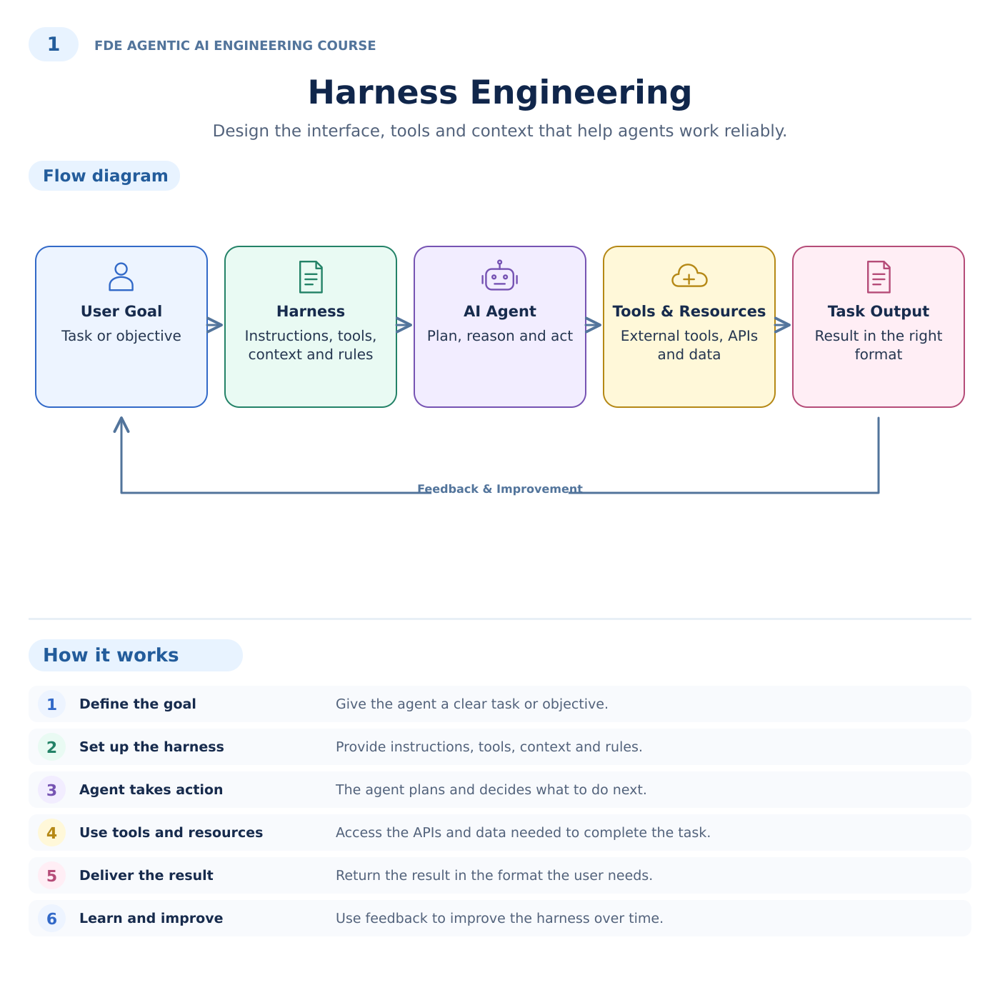

# FDE Agentic AI Engineering Course

Repository: [jbatra-umeey/fde-agentic-ai-engineering-course](https://github.com/jbatra-umeey/fde-agentic-ai-engineering-course).

**A practical course for aspiring Forward Deployed Engineers: turn a customer problem into a reliable agent workflow.**

Ten illustrated modules connect the original diagrams to runnable code, customer discovery, failure drills and production handover. The reference implementation uses Python, FastAPI, Pydantic, SQLite and OpenTelemetry. It includes an authenticated API, a CLI, ten focused walkthroughs and five end-to-end scenarios.

This is a tested reference implementation with production-oriented controls. It is **not a certified production deployment**. Fixture mode is deterministic and uses synthetic data. A configurable live-model adapter is implemented, but live-provider behavior and real external integrations require separate validation. See [verification evidence](reports/VALIDATION.md) and [production readiness](docs/PRODUCTION_READINESS.md).

## Start here

Requires Python 3.12+. Run commands from the repository root.

```bash
python -m venv .venv
source .venv/bin/activate
python -m pip install -r requirements-dev.lock
python -m pip install --no-deps -e .
jev lesson 1
jev demo --simulate-review
jev-eval --output reports/evaluation.json
pytest -q
```

On Windows, activate with `.venv\Scripts\Activate.ps1`. The offline examples need no model key and make no external API calls. `--simulate-review` explicitly simulates an independent reviewer for teaching; the REST API never auto-approves.

## Illustrated learning guide

Each topic has a visual walkthrough with icons, colored cards, directional arrows and a step-by-step explanation. Open the [full diagram gallery](docs/illustrations/README.md) for all ten illustrations and editable SVG downloads.



## Learn the ten disciplines

| Module | What you will deliver |
|---|---|
| [1. Harness Engineering](docs/modules/01-harness-engineering.md) | A bounded, typed execution contract |
| [2. Loop Engineering](docs/modules/02-loop-engineering.md) | A recoverable plan–act–observe loop |
| [3. Context Engineering](docs/modules/03-context-engineering.md) | A scoped and budgeted evidence package |
| [4. Tool Design](docs/modules/04-tool-design.md) | Validated business capabilities |
| [5. Memory Architecture](docs/modules/05-memory-architecture.md) | Consent, isolation, TTL and deletion behavior |
| [6. Orchestration Patterns](docs/modules/06-orchestration-patterns.md) | Research, coding, analysis and planning coordination |
| [7. Guardrails & Permissions](docs/modules/07-guardrails-and-permissions.md) | An authorization matrix and negative tests |
| [8. Evals for Agents](docs/modules/08-evals-for-agents.md) | A measurable release gate |
| [9. Human-in-the-Loop Design](docs/modules/09-human-in-the-loop-design.md) | A durable independent-review workflow |
| [10. Observability & Tracing](docs/modules/10-observability-and-tracing.md) | An explainable run history and support plan |

Each module has the matching diagram, plain-language explanation, code entry point, runnable example, hands-on lab, failure exercise and acceptance criteria. See the [concept-to-code map](docs/CONCEPT_MAP.md) to audit coverage.

## Five customer-facing scenarios

| Scenario | Demonstration | Consequential effect |
|---|---|---|
| Knowledge assistant | Retrieve rollback policy and cite evidence | None |
| Incident triage | Compare latency and propose an investigation | Approved local ticket |
| Mobile performance | Analyze synthetic Android editor latency | Approved local ticket |
| Refund operations | Verify an invoice and review a capped refund | Approved local ledger entry |
| Release readiness | Coordinate four specialist roles | Recommendation only |

Tickets do not reach Jira; refunds do not move money; release recommendations do not deploy code. These boundaries keep the course repeatable and make external integration work explicit.

## Run the API

```bash
python scripts/dev_credentials.py
set -a
source .env
set +a
python scripts/seed.py
uvicorn jev_api.app:create_app --factory --host 127.0.0.1 --port 8000
```

Open `http://127.0.0.1:8000/docs` for the API explorer or follow the complete [request/review walkthrough](docs/API.md). Generated credentials are local teaching identities and are excluded from source control. Use [Docker Compose](docs/OPERATIONS.md) for the container path.

## Course and delivery materials

- [Syllabus and learning paths](course/SYLLABUS.md)
- [FDE field guide: discovery to handover](course/FDE_FIELD_GUIDE.md)
- [Capstone assignment and assessment rubric](course/CAPSTONE.md)
- [Instructor and publication guide](course/INSTRUCTOR_GUIDE.md)
- [Customer discovery template](course/templates/DISCOVERY.md)
- [Acceptance and handover template](course/templates/HANDOVER.md)
- [Architecture, sequence, deployment and state diagrams](docs/ARCHITECTURE.md)
- [Security model](SECURITY.md), [operations](docs/OPERATIONS.md), [design decisions](docs/DECISIONS.md)

## Repository map

| Path | Responsibility |
|---|---|
| `apps/api` | Authenticated REST boundary and API explorer |
| `apps/cli` | Demonstrations and ten lesson runners |
| `packages/core` | Contracts, harness, context, state, providers, telemetry |
| `packages/tools` | Typed, scoped read and write tools |
| `packages/workflows` | Specialist orchestration and synthetic scenarios |
| `packages/evals` | Outcome, trajectory, safety and latency checks |
| `examples` | One executable entry point for each original diagram |
| `course` | Learning path, labs, capstone and customer deliverables |
| `docs` | Design, behavior, operating procedures and readiness gaps |
| `tests` | Functional, security, concurrency, recovery and contract tests |

The directories are monorepo boundaries, released as one Python distribution for straightforward installation. No framework hides the core loop; [design decisions](docs/DECISIONS.md) explain this choice and when to adopt a workflow framework.

## Verification

```bash
ruff check .
ruff format --check .
pytest --cov=jev_core --cov=jev_tools --cov=jev_workflows --cov=jev_api --cov=jev_evals
jev-eval --output reports/evaluation.json
python scripts/check_repository.py
python -m build
```

GitHub Actions runs these checks and builds the container when the repository is published. A workflow file is not evidence that hosted CI has already run.

## Course maintainer

[Jagprit Batra](https://github.com/jbatra-umeey). For teaching sessions and course releases, see the [instructor guide](course/INSTRUCTOR_GUIDE.md).
