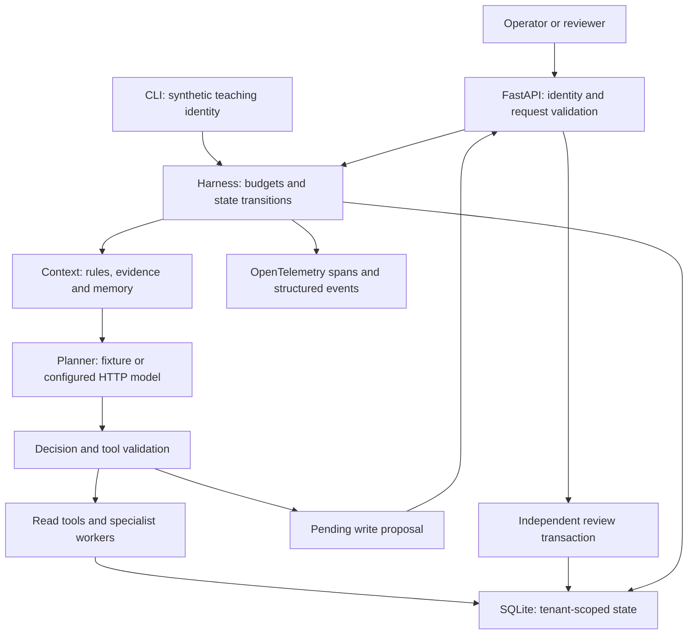
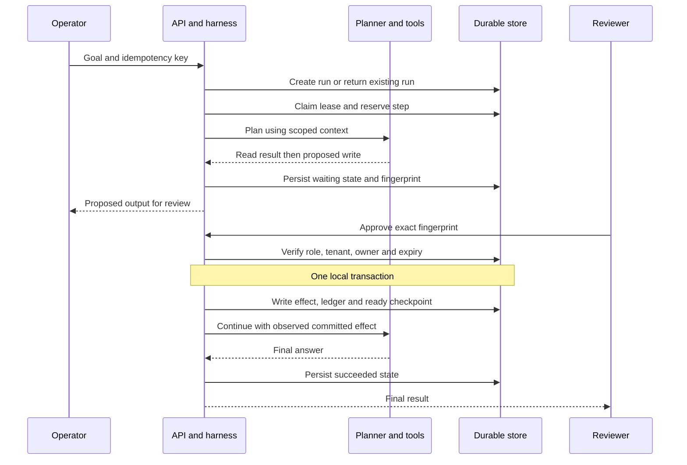
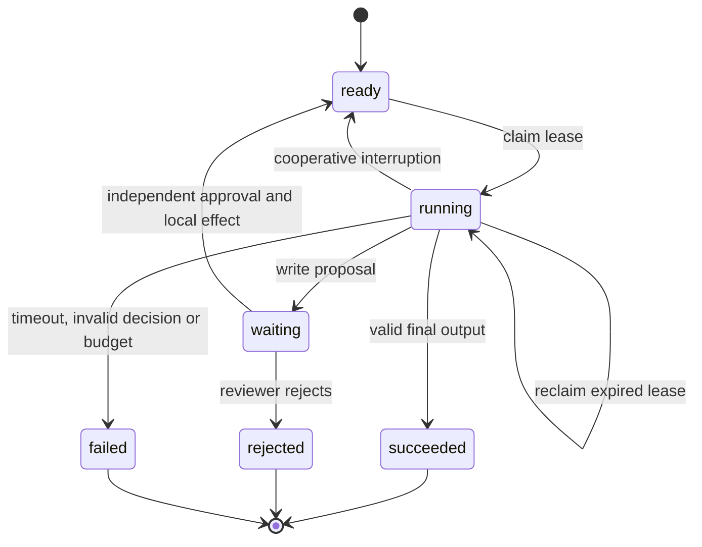
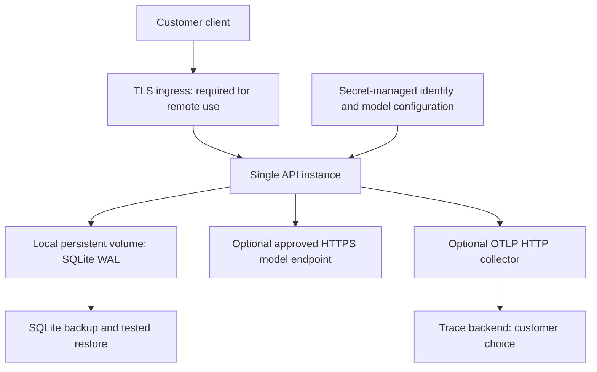

# Implementation architecture

The [concept map](CONCEPT_MAP.md) connects the ten disciplines to their implementation. The diagrams below show how the components work together; the [illustrated guide](illustrations/README.md) introduces each concept.

## Components and trust boundaries

The model receives no database handle, tenant override, authentication token or arbitrary network tool. Server-side code injects identity. Retrieved content and memory are always untrusted input. Optional model requests send the assembled context to the configured provider; deployment owners must approve that data destination.

## Successful reviewed action

If the process stops after approval commits but before final planning, the run remains ready. Resuming sees the effect observation already recorded. Local effect creation and approval cannot partially commit. This guarantee does not extend to remote services.

## State machine

Waiting approvals have a one-hour TTL. An expired review request returns a conflict and leaves the historical proposal intact; an operator must create a new request/key for a new proposal. Failed runs are terminal, preserving diagnostics. A killed worker's lease expires after 45 seconds; the owner can resume with the remaining durable step budget.

## Deployment topology

The provided Compose file binds only to loopback and uses one API worker. TLS ingress, collector, trace backend and external model are not provisioned by the default stack. Do not mount SQLite on a shared network filesystem or scale API replicas without redesigning persistence and coordination.

## State and data model

| Table | Scope and purpose |
|---|---|
| `runs` | Tenant and creator scoped idempotency, serialized request/state, lease |
| `events` | Tenant/run correlated metadata; no prompts or raw provider errors |
| `documents` | Tenant-scoped source IDs and externally maintained content |
| `memory` | Tenant/user/session or cross-session opt-in summaries with TTL |
| `effects` | Tenant/run/step ledger binding approval fingerprint to local result |
| `tickets`, `invoices`, `refunds` | Local example business records |
| `rate_limits` | Per-tenant/user fixed-window counters shared by local processes |

## Failure semantics

| Failure | Behavior | Recovery |
|---|---|---|
| Model timeout or malformed response | Failed run with sanitized error code | Fix cause; submit a new request/key |
| Retryable model HTTP response | Up to three bounded attempts under outer deadline | No write retries are implied |
| Invalid or forbidden tool | Fail closed | Correct contract or authorized scope |
| Concurrent execution | One lease owner; other caller gets conflict | Read run or retry after lease expiry |
| Concurrent review | One local transaction wins | Read final state; do not duplicate business action |
| Invoice changed before review | Revalidate amount at commit | Review updated business state |
| Specialist failure | Cancel peer tasks and fail the run | Diagnose failed specialist before rerun |
| Process kill | Durable checkpoints survive; lease eventually expires | Owner calls resume |
| Storage outage | Request may fail before durable completion | Restore storage; inspect state before retry |

## Source references

The implementation uses [FastAPI testing patterns](https://fastapi.tiangolo.com/advanced/async-tests/), [SQLite transaction semantics](https://www.sqlite.org/lang_transaction.html), [SQLite isolation guidance](https://www.sqlite.org/isolation.html), and [OpenTelemetry Python instrumentation](https://opentelemetry.io/docs/languages/python/instrumentation/). Links document underlying primitives; they do not certify this application.
