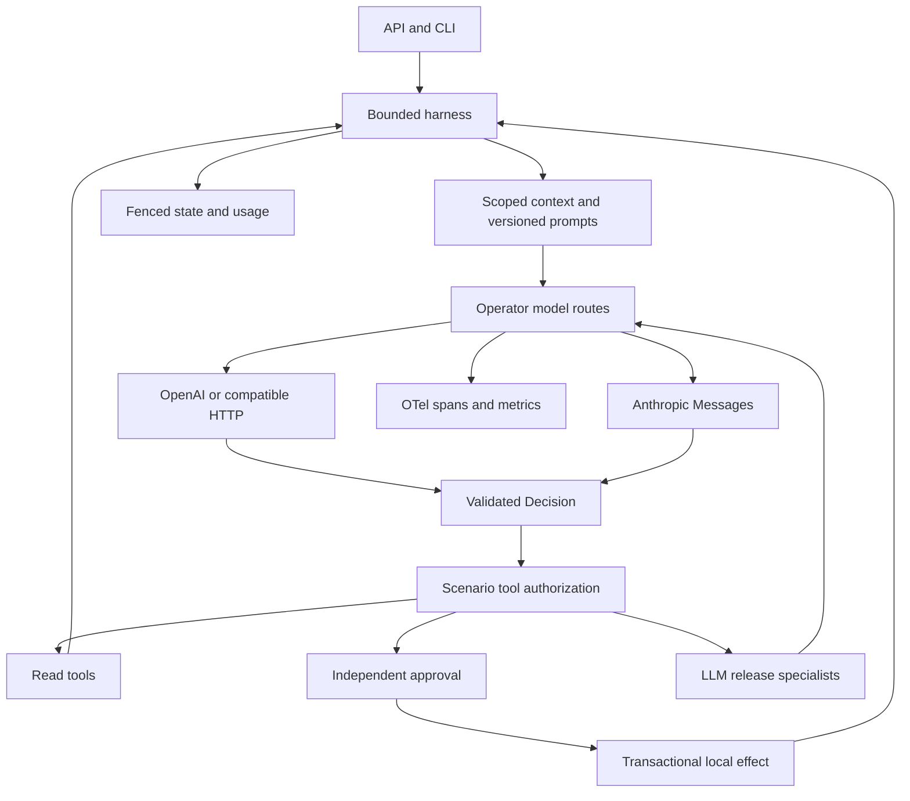
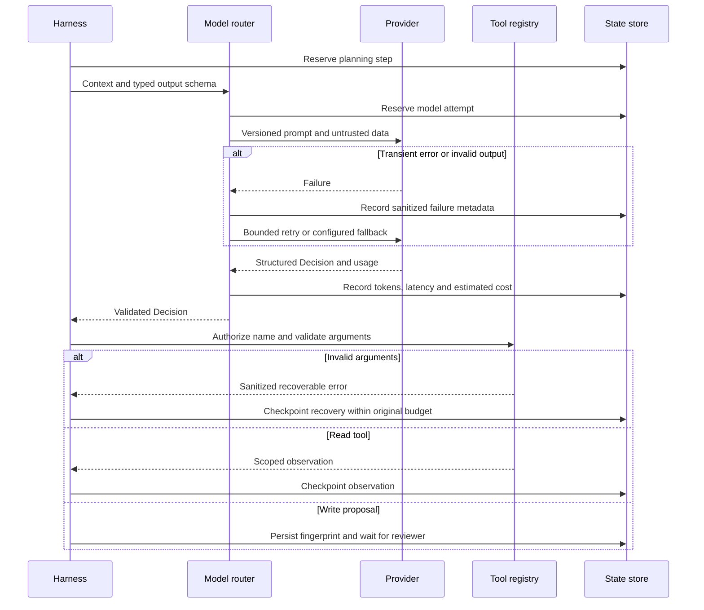
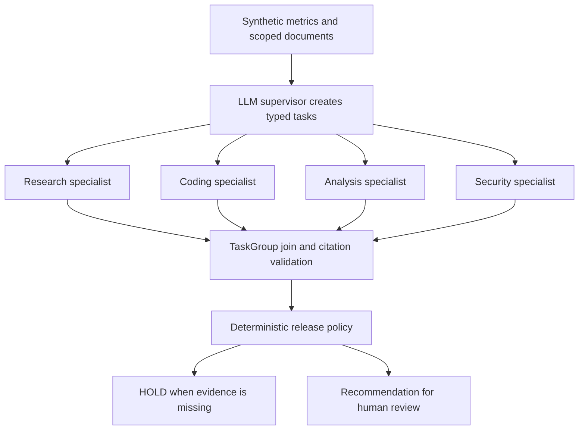
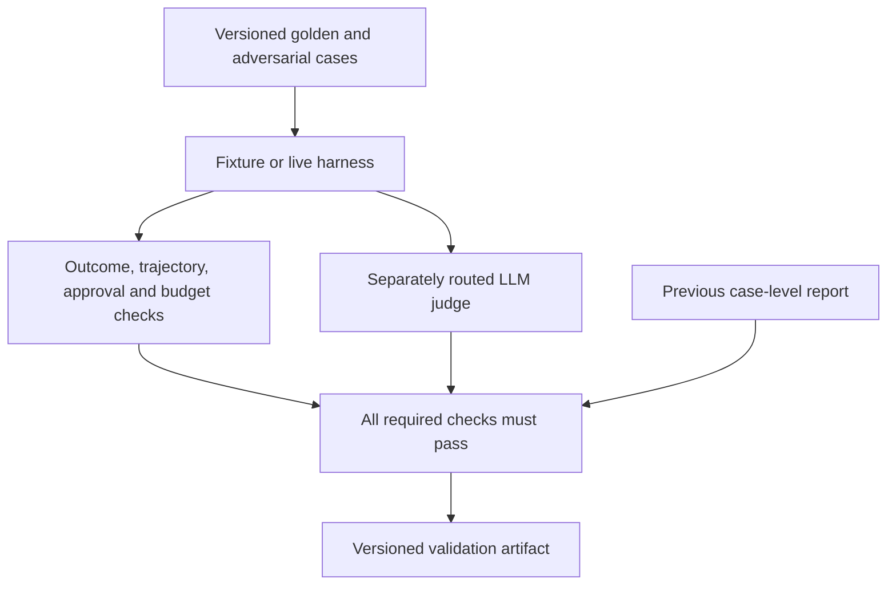
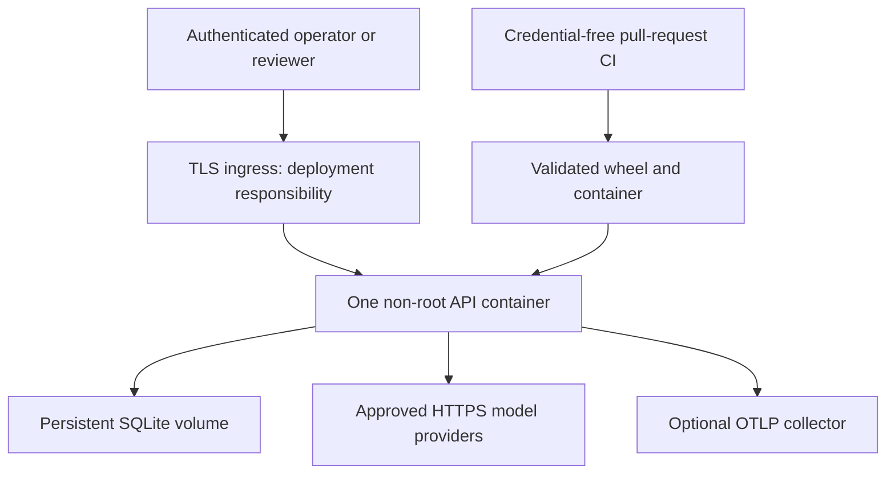

# Production-oriented inference architecture

The original ten modules and illustrations remain the conceptual foundation. This additive implementation connects live inference to their existing runtime. The supplied starter overlay was applied first; its CLI switches were retained and its shared `last_usage` logging was replaced with per-run accounting for concurrency safety.

## Planning, fallback and recovery

The provider can format a candidate action; only the registry grants tool access. Provider failures never invoke business tools. The run's ContextVar isolates usage between requests while sharing a recorder among that run's concurrent specialist tasks. Every model attempt consumes a durable reservation before network I/O.

## Live release review

Analysis and security are required unique roles; research/coding are optional model-selected tasks. TaskGroup cancels peers on a failure. Reports are bounded schemas with risk, missing evidence and source IDs. Suggested code remains inert text. The course supplies no real security scan, so the live release path returns HOLD even if all models are optimistic. The final run exposes `release_recommendation` from the tool policy as the authoritative structured decision; free-form answer text is advisory. The original offline specialist/template example remains available to teach the contrast.

## Evaluation and release gates

Judge output cannot turn a failed deterministic check into a pass. Refusal or invalid judge output fails its gate. Golden cases are synthetic regression data, not evidence of generalized customer quality. No chain-of-thought is requested or stored; evaluation uses observable actions, evidence and final answers.

## Deployment boundary

This is a bounded single-process reference. Customer ingestion, remote side-effect reconciliation, OIDC, distributed scheduling, monetary quotas and high availability require deployment-specific engineering. See the [readiness matrix](PRODUCTION_READINESS.md).
