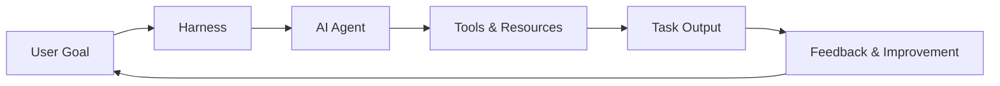

# 1. Harness Engineering

**Photo alignment:** the title, stages, arrows and feedback direction below follow supplied photo 1. Layout is adapted for readable Markdown; implementation safeguards are explained separately.

## Customer problem

A customer has an impressive chatbot demo, but it cannot reliably complete a support task. What must surround the model?

## Understand it simply

The harness is the operating environment around the agent: instructions, identity, context, tools, budgets, persistence and output contracts. The model proposes a next step; the harness decides whether that step is valid.

## Diagram from the photo



## Follow the flow in code

1. Define the goal: create a typed RunRequest with a scenario and measurable outcome.
2. Set up the harness: construct identity-scoped context, tool contracts and fixed budgets.
3. Agent takes action: FixturePlanner or HTTPPlanner returns a typed Decision.
4. Use tools and resources: Registry validates the action and the runtime invokes an allowed handler.
5. Deliver the result: persist an answer, citations and status.
6. Learn and improve: review evaluation failures and version changes through code review.

Start at [packages/core/src/jev_core/runtime.py](../../packages/core/src/jev_core/runtime.py). The executable walkthrough is [example 01](../../examples/01-harness-engineering/main.py).

## Run the example

From the repository root after installation:

```bash
jev lesson 1
```

Expected: A succeeded knowledge run with a search observation, a cited rollback answer, and a durable event sequence.

## Hands-on lab

Add an onboarding-policy document and a read-only scenario. Define the outcome before changing the prompt. Extend the scenario allowlist and add an evaluation case.

Failure drill: Ask the planner to invoke a tool that is not in the scenario allowlist. The run must fail with tool_not_allowed and no write.

Submit: A one-page customer outcome brief and a tested scenario contract.

Acceptance criteria: A repeated idempotency key returns the same run; changed input under that key is rejected; unsupported tools never execute.

## FDE decision checkpoint

Clarify who owns the result, what counts as success and which systems the agent may touch before choosing a model.

Write down the assumption, customer evidence, selected tradeoff and rollback condition before moving to the next module. Explain your choice to a non-specialist stakeholder in two minutes.

## Production boundary

A regulated deployment needs its own retention, access-control and model approval review; these are deployment responsibilities.

## Review and teach-back

1. Explain each arrow in this module's diagram using the example's data.
2. Identify the authoritative decision boundary and demonstrate its failure test.
3. Name one assumption that would change for your customer and how you would validate it.

[Course syllabus](../../course/SYLLABUS.md) · [Photo-to-code map](../PHOTO_ALIGNMENT.md) · [Production readiness](../PRODUCTION_READINESS.md)

