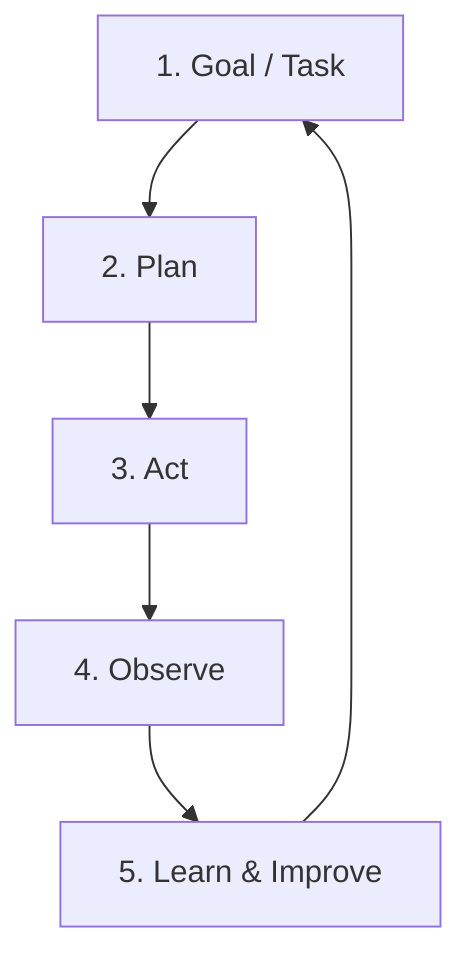

# 2. Loop Engineering

**Photo alignment:** the title, stages, arrows and feedback direction below follow supplied photo 2. Layout is adapted for readable Markdown; implementation safeguards are explained separately.

## Customer problem

An operations team wants an agent to investigate a latency incident without running forever or repeatedly opening tickets.

## Understand it simply

A loop is a sequence of plan, act and observe steps. Each observation changes what the next planning step can see. Learning here means updating the next decision and improving reviewed prompts or policies; it does not mean automatic model-weight training.

## Diagram from the photo



## Follow the flow in code

1. Set the goal: investigate a synthetic latency regression.
2. Plan and decide: choose a metrics read before proposing a ticket.
3. Execute actions: run analyze_metrics through the tool registry.
4. Check and evaluate: persist measured p95 change as an observation.
5. Learn and improve: the next planner call uses that observation to propose a ticket; review failures inform the next version.

Start at [packages/core/src/jev_core/runtime.py](../../packages/core/src/jev_core/runtime.py). The executable walkthrough is [example 02](../../examples/02-loop-engineering/main.py).

## Run the example

From the repository root after installation:

```bash
jev lesson 2
```

Expected: A waiting incident run: metrics were read, a ticket was proposed, and no ticket exists until review.

## Hands-on lab

Create a planner that repeatedly searches the same document. Set max_steps to three and demonstrate deterministic termination. Then change the planner to stop when it has sufficient evidence.

Failure drill: Cancel execution during planning and resume it. The reserved step must remain counted. Expire a lease and prove an old worker cannot checkpoint.

Submit: A state-transition trace explaining every stop condition and restart boundary.

Acceptance criteria: Infinite planning terminates; interruption preserves the budget; rejected review ends the run; write effects do not repeat.

## FDE decision checkpoint

Discuss timeout and recovery behavior with the customer's on-call team, not just with the model specialist.

Write down the assumption, customer evidence, selected tradeoff and rollback condition before moving to the next module. Explain your choice to a non-specialist stakeholder in two minutes.

## Production boundary

There is a per-invocation deadline and a durable step budget. Distributed scheduling and monetary token-budget enforcement are future work.

## Review and teach-back

1. Explain each arrow in this module's diagram using the example's data.
2. Identify the authoritative decision boundary and demonstrate its failure test.
3. Name one assumption that would change for your customer and how you would validate it.

[Course syllabus](../../course/SYLLABUS.md) · [Photo-to-code map](../PHOTO_ALIGNMENT.md) · [Production readiness](../PRODUCTION_READINESS.md)

