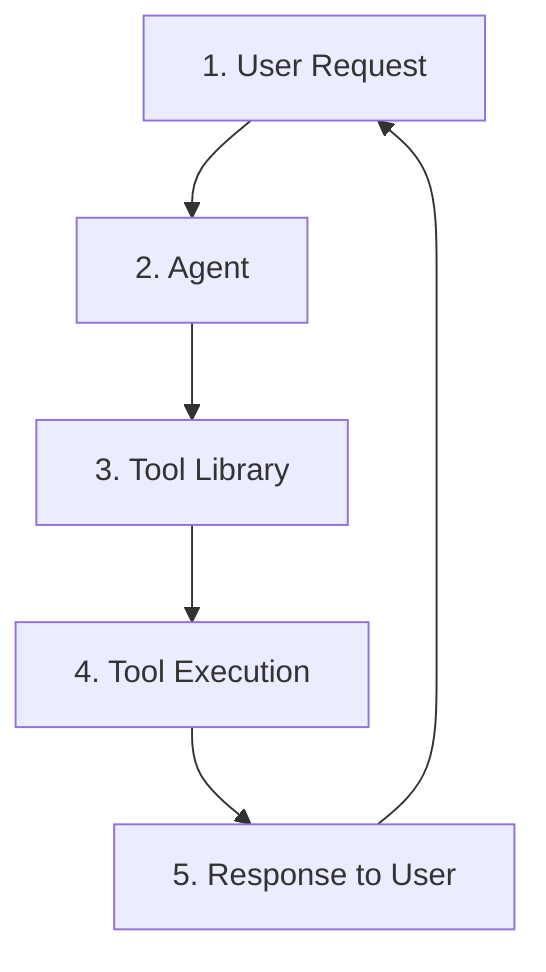

# 4. Tool Design

## Customer problem

A customer says 'let the agent use our APIs'. Which operations should become tools, and how should failures be represented?

## Understand it simply

A tool is a narrow typed capability, not a general-purpose command channel. Its name, description, input schema, read/write classification and permission boundary tell the agent how it may act.

## Illustrated overview


[Download editable SVG](../diagrams/04-tool-design.svg?v=footer-free-2)

## Technical flow



## Follow the flow in code

1. User request: supply a concrete goal such as finding the rollback policy.
2. Agent decision: choose search_knowledge and a query.
3. Tool library: discover schemas and only the scenario's allowed tools.
4. Tool execution: validate arguments, enforce timeout, inject the authenticated identity and execute the handler.
5. Response to user: use observed results rather than assuming a successful action.

Start at [packages/tools/src/jev_tools/registry.py](../../packages/tools/src/jev_tools/registry.py). The executable walkthrough is [example 04](../../examples/04-tool-design/main.py).

## Run the example

From the repository root after installation:

```bash
jev lesson 4
```

Expected: A tool contract and retrieved rollback evidence, including source identifiers.

## Hands-on lab

Add a read-only get_release_status tool. Use an enum for release state, reject unknown fields, bound identifiers and give unavailable-data behavior a clear meaning.

Failure drill: Supply amount_cents as a string, a negative value, a boolean or a value over the refund cap. Try adding a tenant override to the arguments.

Submit: A tool specification with inputs, outputs, authorization, timeout, idempotency and error semantics.

Acceptance criteria: All malformed arguments fail; identity is injected by the server; no shell or arbitrary URL tool is available.

## FDE decision checkpoint

Design tools around customer business operations. A small safe API often delivers more reliability than a broad tool catalog.

Write down the assumption, customer evidence, selected tradeoff and rollback condition before moving to the next module. Explain your choice to a non-specialist stakeholder in two minutes.

## Production boundary

Local write effects are transactional. A remote connector needs downstream idempotency keys, an outbox and reconciliation; do not copy a network call into the SQLite transaction.

## Review and teach-back

1. Explain each arrow in this module's diagram using the example's data.
2. Identify the authoritative decision boundary and demonstrate its failure test.
3. Name one assumption that would change for your customer and how you would validate it.

[Course syllabus](../../course/SYLLABUS.md) · [Concept-to-code map](../PHOTO_ALIGNMENT.md) · [Production readiness](../PRODUCTION_READINESS.md)

