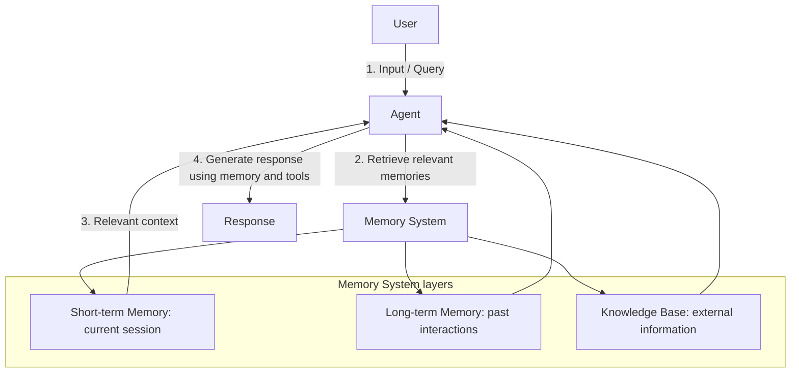

# 5. Memory Architecture

## Customer problem

An agent should remember useful context across sessions, but the customer needs isolation, expiry and a way to forget.

## Understand it simply

Short-term memory describes the current session. Long-term memory carries approved, time-limited summaries across sessions. The knowledge base is externally maintained reference information. These stores have different ownership and retention rules.

## Illustrated overview


[Download editable SVG](../diagrams/05-memory-architecture.svg?v=footer-free-2)

## Technical flow



## Follow the flow in code

1. User input: identify the tenant, subject and session.
2. Retrieve memory: load unexpired session and cross-session summaries; separately retrieve knowledge.
3. Use context: add memory as untrusted data, never as system instructions.
4. Generate response: plan and act with the selected context.
5. Update memory: only remember when explicitly requested; expose deletion and scheduled expiry cleanup.

Start at [packages/core/src/jev_core/store.py](../../packages/core/src/jev_core/store.py). The executable walkthrough is [example 05](../../examples/05-memory-architecture/main.py).

## Run the example

From the repository root after installation:

```bash
jev lesson 5
```

Expected: Two stored summaries after an opt-in run and an empty memory result after explicit deletion.

## Hands-on lab

Use two sessions for the same user and a second user in the same tenant. Show which memory crosses the session boundary and which cannot cross the user boundary.

Failure drill: Expire memory and confirm retrieval omits it before physical cleanup. Delete memory and verify it does not reappear on the next read.

Submit: A memory policy covering consent, TTL, deletion, purpose and ownership.

Acceptance criteria: Session isolation, subject isolation and tenant isolation pass; expired records are excluded; opt-out is the default.

## FDE decision checkpoint

Ask whether the customer truly needs long-term memory. Less retained information can simplify both operations and trust.

Write down the assumption, customer evidence, selected tradeoff and rollback condition before moving to the next module. Explain your choice to a non-specialist stakeholder in two minutes.

## Production boundary

Deleting memory does not delete run history or backups. Run/effect retention and legal deletion workflows must be defined before production.

## Review and teach-back

1. Explain each arrow in this module's diagram using the example's data.
2. Identify the authoritative decision boundary and demonstrate its failure test.
3. Name one assumption that would change for your customer and how you would validate it.

[Course syllabus](../../course/SYLLABUS.md) · [Concept-to-code map](../PHOTO_ALIGNMENT.md) · [Production readiness](../PRODUCTION_READINESS.md)

