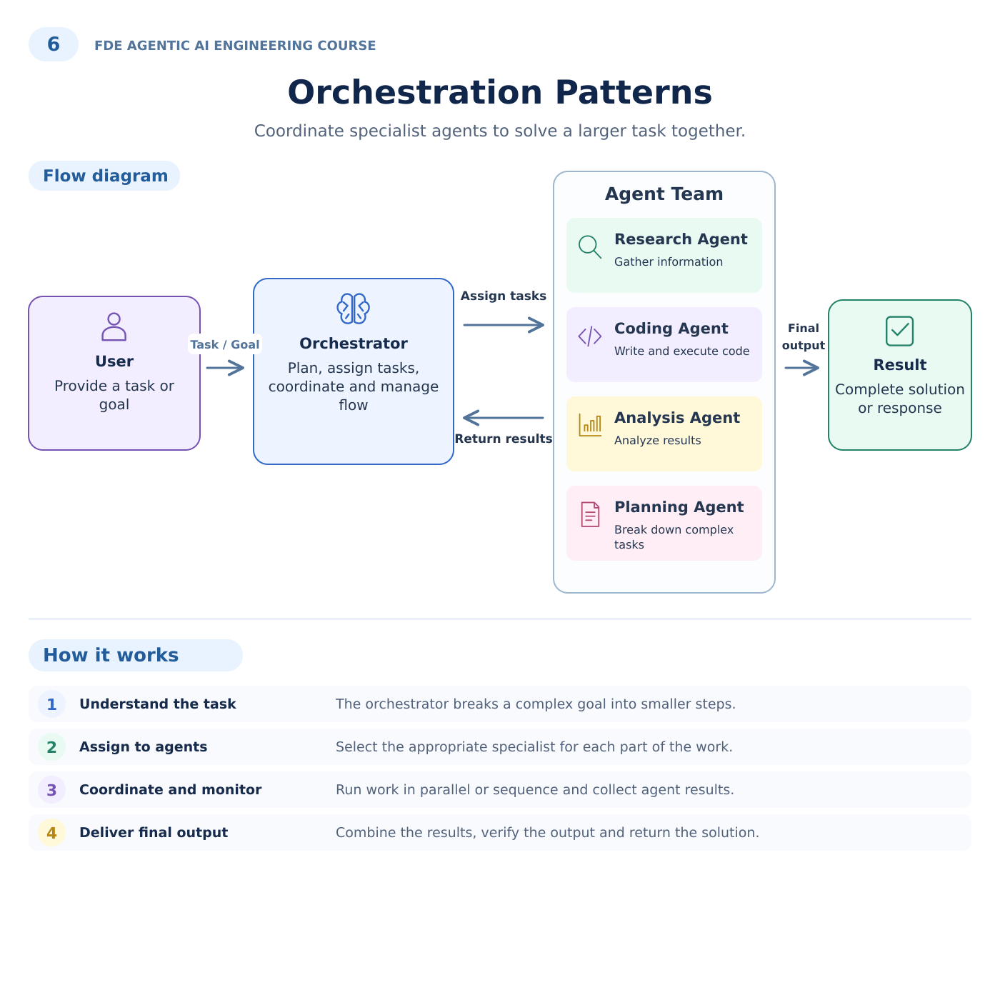
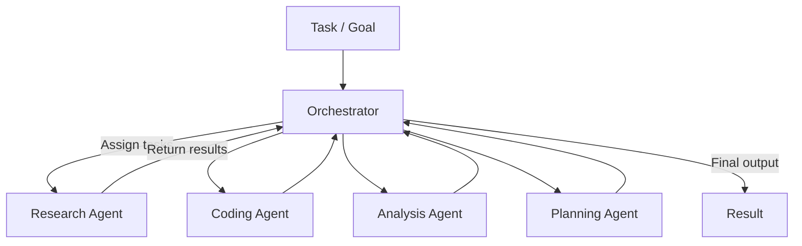

# 6. Orchestration Patterns

## Customer problem

A release decision needs research, a code artifact, analysis and planning. How can specialists collaborate without losing control of the final recommendation?

## Understand it simply

The orchestrator owns assignment, coordination and aggregation. In the reference example, a planning specialist defines bounded work; research, coding and analysis specialists run concurrently; the orchestrator checks their results before returning a recommendation.

## Illustrated overview



[Download editable SVG](../illustrations/06-orchestration-patterns.svg)

## Technical flow



## Follow the flow in code

1. Understand the task: route the goal and create a bounded specialist plan.
2. Assign agents: research gathers source IDs; coding creates and executes trusted template code; analysis checks fixture metrics; planning defines the work.
3. Coordinate and monitor: run independent work in a TaskGroup and cancel siblings if a specialist fails.
4. Deliver final output: aggregate results into HOLD or PROCEED_TO_HUMAN_REVIEW; no deployment occurs.

Start at [packages/workflows/src/jev_workflows/patterns.py](../../packages/workflows/src/jev_workflows/patterns.py). The executable walkthrough is [example 06](../../examples/06-orchestration-patterns/main.py).

## Run the example

From the repository root after installation:

```bash
jev lesson 6
```

Expected: Four specialist results, a generated release-gate function with three executed checks, and a release recommendation.

## Hands-on lab

Add a reliability specialist and make its failure block the recommendation. Compare sequential and parallel composition while preserving the same acceptance criteria.

Failure drill: Make one specialist raise an exception. Verify the group fails rather than silently producing a partially checked recommendation.

Submit: A task allocation diagram and a table explaining when sequential, parallel and supervisor routing are appropriate.

Acceptance criteria: Independent workers overlap; failure cancels peers; all four specialist roles are present; the final decision accounts for the analysis.

## FDE decision checkpoint

Use specialists when independent responsibilities justify coordination cost. Multiple prompts alone do not create a reliable team.

Write down the assumption, customer evidence, selected tradeoff and rollback condition before moving to the next module. Explain your choice to a non-specialist stakeholder in two minutes.

## Production boundary

These specialist agents are deterministic reference workers. The coding worker executes only a fixed trusted template; it is not a sandbox for arbitrary LLM-generated code.

## Review and teach-back

1. Explain each arrow in this module's diagram using the example's data.
2. Identify the authoritative decision boundary and demonstrate its failure test.
3. Name one assumption that would change for your customer and how you would validate it.

[Course syllabus](../../course/SYLLABUS.md) · [Concept-to-code map](../CONCEPT_MAP.md) · [Production readiness](../PRODUCTION_READINESS.md)

