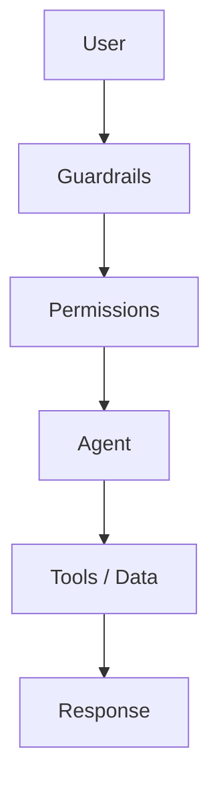

# 7. Guardrails & Permissions

## Customer problem

A model proposes a refund for the wrong customer. Where should the system stop it, even if the model insists?

## Understand it simply

Guardrails validate the request and output. Permissions determine who may access a resource or perform an action. Both are server-side decisions. An instruction in a prompt is not authorization.

## Illustrated overview


[Download editable SVG](../diagrams/07-guardrails-and-permissions.svg?v=footer-free-2)

## Technical flow



## Follow the flow in code

1. Guardrails check: reject malformed requests, excessive bodies and invalid tool arguments.
2. Permissions verify: authenticate a server-configured identity and enforce role, tenant and scenario policy.
3. Agent executes: allow only approved tools and scoped data access.
4. Safe outcome: require independent approval for writes and persist a constrained result.

Start at [apps/api/src/jev_api/security.py](../../apps/api/src/jev_api/security.py). The executable walkthrough is [example 07](../../examples/07-guardrails-and-permissions/main.py).

## Run the example

From the repository root after installation:

```bash
jev lesson 7
```

Expected: Attempts to use a refund tool, shell or arbitrary HTTP tool in the knowledge scenario are denied.

## Hands-on lab

Create an operator, reader and reviewer in two tenants. Build an authorization matrix covering create, read, review, resume and memory deletion.

Failure drill: Try a cross-tenant run ID; request a write as a reader; attempt self-approval; change the reviewed payload fingerprint.

Submit: A threat model and access matrix with executable negative tests.

Acceptance criteria: Anonymous requests fail; unauthorized actions fail; cross-tenant resources return 404; an operator cannot approve their own write.

## FDE decision checkpoint

Validate identity and data boundaries with the customer security team early. These decisions shape the integration architecture.

Write down the assumption, customer evidence, selected tradeoff and rollback condition before moving to the next module. Explain your choice to a non-specialist stakeholder in two minutes.

## Production boundary

Policy checks are not a full harmful-content classifier or DLP system. OIDC, fine-grained in-tenant ACLs, TLS ingress and production secret rotation remain deployment work.

## Review and teach-back

1. Explain each arrow in this module's diagram using the example's data.
2. Identify the authoritative decision boundary and demonstrate its failure test.
3. Name one assumption that would change for your customer and how you would validate it.

[Course syllabus](../../course/SYLLABUS.md) · [Concept-to-code map](../PHOTO_ALIGNMENT.md) · [Production readiness](../PRODUCTION_READINESS.md)

