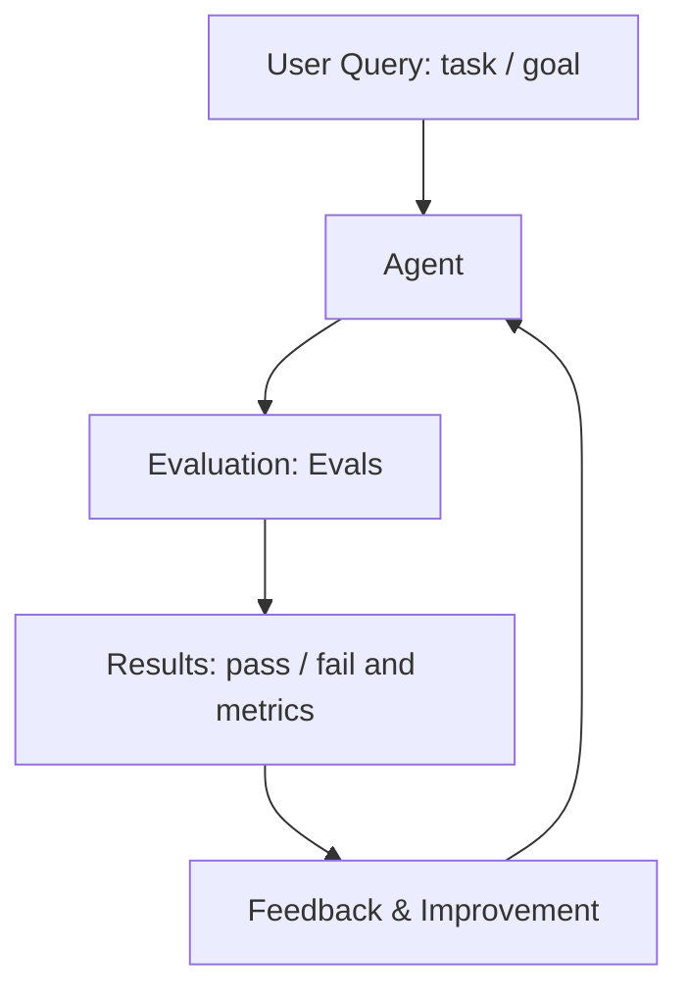

# 8. Evals for Agents

**Photo alignment:** the title, stages, arrows and feedback direction below follow supplied photo 8. Layout is adapted for readable Markdown; implementation safeguards are explained separately.

## Customer problem

The demo looks better after a prompt change. How do you know whether the agent became safer and more useful?

## Understand it simply

Evaluation turns customer expectations into repeatable checks. Outcome checks assess the final result; trajectory checks inspect tool behavior; safety checks ensure actions obey policy. Latency is recorded separately so a fast incorrect result never counts as success.

## Diagram from the photo



## Follow the flow in code

1. Define the task: describe input, expected tools, answer criteria and citations.
2. Run the agent: execute the same harness used by the API.
3. Evaluate the output: score outcome, trajectory, approval safety, citations and budget.
4. Get feedback: emit a JSON report identifying failed scenarios.
5. Iterate and improve: revise prompts, tools or policies through review and rerun the gate.

Start at [packages/evals/src/jev_evals/runner.py](../../packages/evals/src/jev_evals/runner.py). The executable walkthrough is [example 08](../../examples/08-evals-for-agents/main.py).

## Run the example

From the repository root after installation:

```bash
jev lesson 8
```

Expected: Five scenario results with checks, step counts, latency and a machine-readable release gate.

## Hands-on lab

Add a negative refund case and a no-evidence knowledge case. Keep a separate held-out set before introducing a live model. Show an intentionally incorrect planner failing the gate.

Failure drill: Replace the planner with one that returns an unsupported answer. The evaluation must fail rather than merely checking HTTP status.

Submit: An evaluation card describing dataset origin, rubric, baseline, failures and decision threshold.

Acceptance criteria: A good fixture passes; an injected bad planner fails; release gating uses correctness checks; reports label synthetic data.

## FDE decision checkpoint

Choose metrics with the customer. Measure task completion and operational risk, not only answer fluency.

Write down the assumption, customer evidence, selected tradeoff and rollback condition before moving to the next module. Explain your choice to a non-specialist stakeholder in two minutes.

## Production boundary

Five synthetic cases do not establish model quality. Before launch, add labeled customer data, adversarial cases, stochastic repeats, judge calibration and human review.

## Review and teach-back

1. Explain each arrow in this module's diagram using the example's data.
2. Identify the authoritative decision boundary and demonstrate its failure test.
3. Name one assumption that would change for your customer and how you would validate it.

[Course syllabus](../../course/SYLLABUS.md) · [Photo-to-code map](../PHOTO_ALIGNMENT.md) · [Production readiness](../PRODUCTION_READINESS.md)

