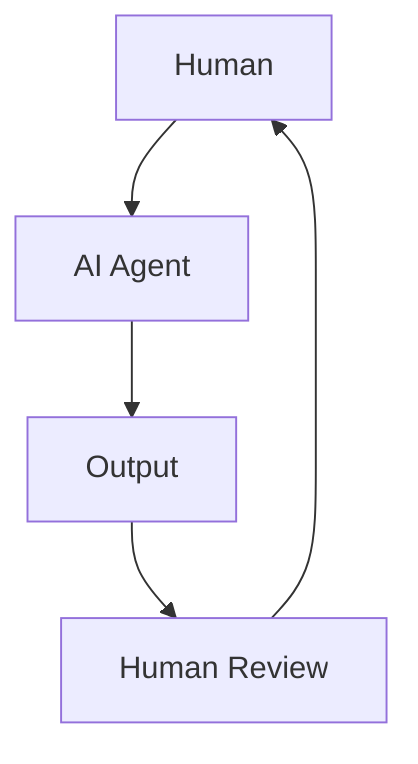

# 9. Human-in-the-Loop Design

**Photo alignment:** the title, stages, arrows and feedback direction below follow supplied photo 9. Layout is adapted for readable Markdown; implementation safeguards are explained separately.

## Customer problem

The agent should prepare a consequential action, but an accountable person must decide whether it happens.

## Understand it simply

The photo's flow is preserved: a human sets the goal, the agent produces an output, a human reviews it, and feedback informs the next step. For a write operation, the first output is a proposal. The actual effect follows approval so review can still prevent harm.

## Diagram from the photo



## Follow the flow in code

1. Human sets the goal: supply objective and constraints.
2. AI agent takes action: read evidence and produce a proposed output.
3. Human reviews the result: inspect exact arguments, expiry and fingerprint; approve or reject independently.
4. Iterate and improve: accepted results enter the next planning step; rejected results terminate and can inform a revised user goal.

Start at [packages/core/src/jev_core/store.py](../../packages/core/src/jev_core/store.py). The executable walkthrough is [example 09](../../examples/09-human-in-the-loop-design/main.py).

## Run the example

From the repository root after installation:

```bash
jev lesson 9
```

Expected: The original proposal, a clearly labeled simulated review, an approved local ticket, and a final answer.

## Hands-on lab

Start the API scenario with an operator token, stop before review, restart the service, then review with the reviewer token. Reject a second proposal and compare histories.

Failure drill: Submit the same approval twice concurrently. Verify exactly one local effect. Then try approving an expired or modified proposal.

Submit: A reviewer checklist and a sequence trace showing proposal, decision and committed effect.

Acceptance criteria: No write before approval; approval binds tenant, run, step, tool and arguments; self-review fails; the local effect and checkpoint commit atomically.

## FDE decision checkpoint

Design reviewer workload and escalation ownership. Human-in-the-loop fails operationally when nobody knows who should respond.

Write down the assumption, customer evidence, selected tradeoff and rollback condition before moving to the next module. Explain your choice to a non-specialist stakeholder in two minutes.

## Production boundary

Approval expires after one hour. There is no notification service or expiry scheduler; those need customer-specific integration. The CLI's simulated reviewer is for teaching only.

## Review and teach-back

1. Explain each arrow in this module's diagram using the example's data.
2. Identify the authoritative decision boundary and demonstrate its failure test.
3. Name one assumption that would change for your customer and how you would validate it.

[Course syllabus](../../course/SYLLABUS.md) · [Photo-to-code map](../PHOTO_ALIGNMENT.md) · [Production readiness](../PRODUCTION_READINESS.md)

