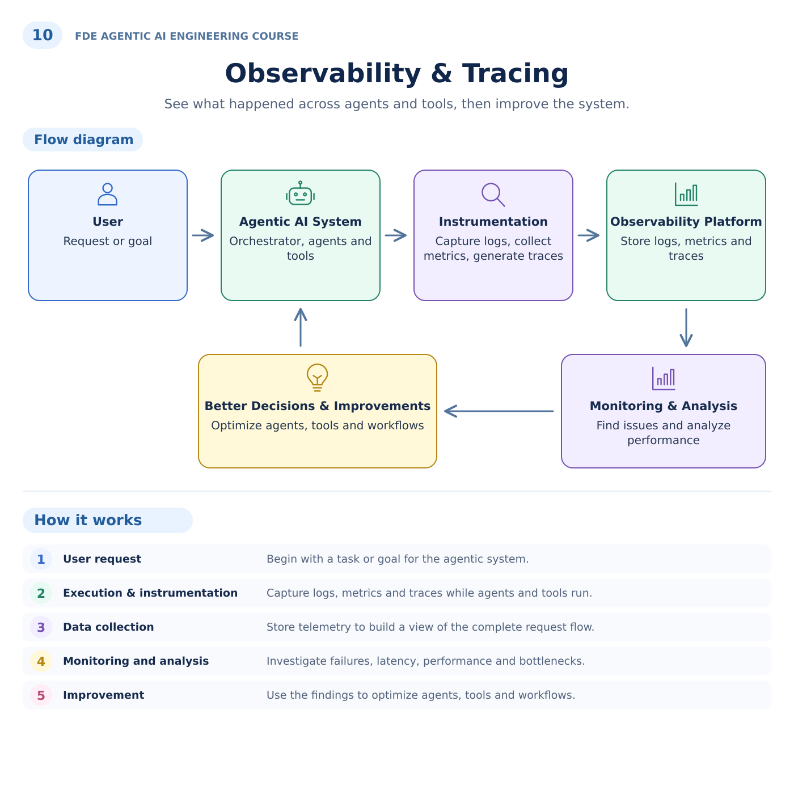
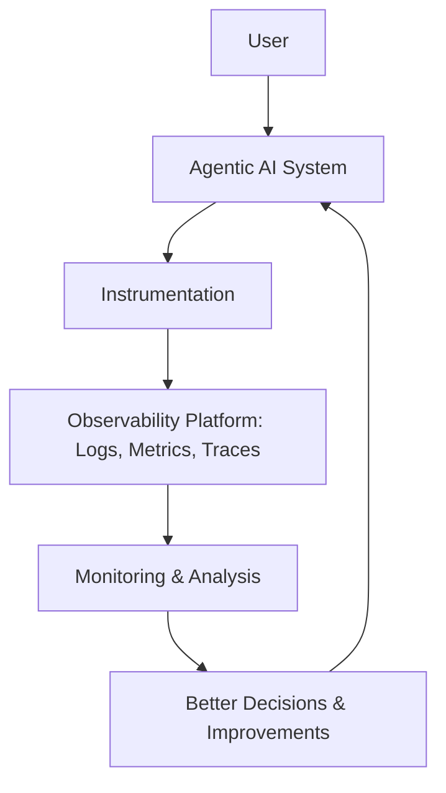

# 10. Observability & Tracing

## Customer problem

A customer reports intermittent agent failures. How do you explain what happened without exposing prompts or confidential records in telemetry?

## Understand it simply

Events record business transitions, metrics summarize outcomes, and traces show nested execution timing. Use the run ID to connect them. Capture enough metadata to diagnose behavior while keeping sensitive payloads out of telemetry.

## Illustrated overview



[Download editable SVG](../illustrations/10-observability-and-tracing.svg)

## Technical flow



## Follow the flow in code

1. User request: assign a durable run ID.
2. Execution and instrumentation: emit run, planner and tool spans plus structured events.
3. Data collection: retain event metadata locally and optionally export spans through OTLP.
4. Monitoring and analysis: inspect status counts, duration, step usage and error codes.
5. Improvement: use observed failures to revise workflows and rerun evaluations.

Start at [packages/core/src/jev_core/telemetry.py](../../packages/core/src/jev_core/telemetry.py). The executable walkthrough is [example 10](../../examples/10-observability-and-tracing/main.py).

## Run the example

From the repository root after installation:

```bash
jev lesson 10
```

Expected: Nested in-memory spans, parent identifiers and structured events with the same run ID; no raw prompts or exception messages.

## Hands-on lab

Trigger a tool denial and a timeout. Compare their events and traces. Configure an OTLP collector in a controlled environment and confirm a received span before claiming export works.

Failure drill: Raise an exception containing a fake secret. Confirm only its class appears in trace status and API error fields.

Submit: An operations dashboard specification, alert definitions and an incident runbook.

Acceptance criteria: Trace parentage is valid; metadata correlates by run ID; raw exception messages are excluded; run status metrics are tenant-scoped.

## FDE decision checkpoint

Agree on actionable alerts and support ownership before launch. A dashboard without an operator response is not an operating model.

Write down the assumption, customer evidence, selected tradeoff and rollback condition before moving to the next module. Explain your choice to a non-specialist stakeholder in two minutes.

## Production boundary

An OTLP HTTP exporter is implemented, but no collector/backend deployment is validated here. Multi-request trace stitching uses run IDs, not a single continued trace.

## Review and teach-back

1. Explain each arrow in this module's diagram using the example's data.
2. Identify the authoritative decision boundary and demonstrate its failure test.
3. Name one assumption that would change for your customer and how you would validate it.

[Course syllabus](../../course/SYLLABUS.md) · [Concept-to-code map](../CONCEPT_MAP.md) · [Production readiness](../PRODUCTION_READINESS.md)


## Live systems extension

Complete this module’s exercise in the [ten-module live practicum](../../course/labs/LIVE_SYSTEMS.md), using the [provider setup](../LIVE_INFERENCE.md) and [evaluation gates](../EVALUATION.md). The original walkthrough above remains the offline foundation.
